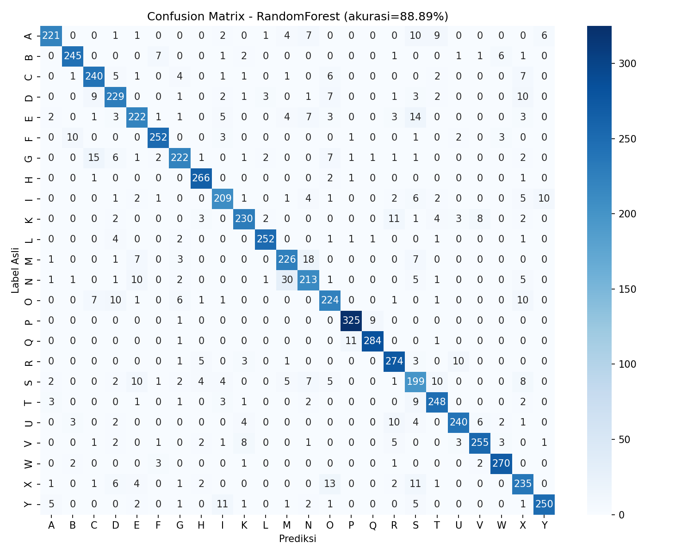

# Sign Language Translator (ASL Fingerspelling)

A machine learning model that translates ASL fingerspelling hand signs into letters, trained on hand landmark data from [MediaPipe Hands](https://ai.google.dev/edge/mediapipe/solutions/vision/hand_landmarker). Includes a real-time demo that reads hand signs straight from a webcam.



## ✨ Features

- Complete training pipeline, from raw CSV data to a ready-to-use model
- Scale- and position-invariant landmark normalization — stays accurate regardless of hand position or distance from the camera
- Automatic comparison of several algorithms (Random Forest, Extra Trees, SVM) to pick the best-performing model
- Real-time demo: webcam → hand detection → letter prediction, displayed live on screen

## 📁 Project Structure

```
.
├── data.csv                     # Hand landmark dataset (21 x,y points per sample + letter label)
├── train_sign_language.py       # Training script, builds the model from data.csv
├── sign_language_model.pkl      # Trained, ready-to-use model (RandomForest)
├── predict_example.py           # Example of predicting from existing landmark data
├── realtime_translate.py        # Real-time webcam demo
├── confusion_matrix.png         # Model evaluation visualization
├── training_report.json         # Detailed metrics & model comparison
├── requirements.txt             # List of dependencies
├── .gitignore
└── README.md
```

## 📊 About the Dataset

- **Input**: 21 hand landmark points (x, y coordinates) from MediaPipe Hands → 42 features per sample
- **Labels**: 24 letters of the alphabet (A–Y, excluding **J** and **Z** since both are motion-based signs rather than static poses)
- **Size**: ~32,800 rows after cleaning out empty/invalid rows

## 🧠 Model

| | |
|---|---|
| Algorithm | Random Forest (250 trees, max_depth=22) |
| Test accuracy | **88.9%** |
| File size | ~45 MB |
| Normalization | Wrist-centered + scale-invariant |

Full details on model comparison and per-class metrics are in `training_report.json`.

## 🔧 Requirements

> ⚠️ **Important:** MediaPipe officially supports only **Python 3.9 – 3.12**. Make sure you are **not** using Python 3.13/3.14 — the mediapipe install will appear to succeed but will actually be broken (`AttributeError: module 'mediapipe' has no attribute 'solutions'`).

Dependencies (see also `requirements.txt`):

```
numpy<2
opencv-contrib-python
mediapipe
scikit-learn
joblib
pandas
matplotlib
seaborn
```

## 🚀 Installation

```bash
# 1. Clone this repo
git clone https://github.com/unexpectedlyzero/sign-translator

# 2. Create a virtual environment using Python 3.9–3.12 (3.11 recommended)
py -3.11 -m venv venv311
venv311\Scripts\activate        # Windows
# source venv311/bin/activate   # macOS/Linux

# 3. Install dependencies
pip install -r requirements.txt
```

## ▶️ Usage

### Retrain the model from data.csv

```bash
python train_sign_language.py
```

This produces `sign_language_model.pkl`, `confusion_matrix.png`, and `training_report.json`.

### Predict from existing landmark data

```bash
python predict_example.py
```

### Real-time webcam demo

```bash
python realtime_translate.py
```

Show your hand to the camera — the predicted letter appears in the top-left corner. Press `q` to quit.

## 🩹 Troubleshooting

| Issue | Cause | Fix |
|---|---|---|
| `No module named 'sklearn'` | scikit-learn is not installed | `pip install scikit-learn` |
| `InconsistentVersionWarning` when loading the model | scikit-learn version differs from the one used during training | Safe to ignore if the model still works correctly; otherwise match the scikit-learn version or retrain the model |
| `module 'mediapipe' has no attribute 'solutions'` | Python 3.13+ (not yet supported by mediapipe), or a corrupted/incomplete mediapipe install | Use Python 3.9–3.12, then `pip uninstall mediapipe`, `pip cache purge`, and reinstall with `pip install mediapipe --no-cache-dir` |
| `ReadTimeoutError` during `pip install` | Internet connection dropped mid-download | Re-run the install command, or add `--timeout 180` |
| Webcam not detected | Wrong camera index / permission denied | Try changing `cv2.VideoCapture(0)` to a different index (1, 2, etc.) in `realtime_translate.py` |

## 📝 License

Add a license that fits your project's needs (MIT, Apache 2.0, etc.).
